# tinyeasings

[](https://github.com/varnholt/tinyeasings/actions/workflows/ci.yml)

Easing functions for C++23 in a single header, following the formulas from
[easings.net](https://easings.net).

- one header, no dependencies: copy `include/tinyeasings/tinyeasings.hpp` into your project
- or use it as a CMake library: `add_subdirectory`, `FetchContent` or `find_package`
- `constexpr` and `noexcept`, works with `float`, `double` and `long double`
- every curve returns exactly 0 at x = 0 and exactly 1 at x = 1
- select a curve at runtime with the `tinyeasings::Curve` enum

## Usage

```cpp
#include <tinyeasings/tinyeasings.hpp>

// x is expected in [0, 1]
const float y = tinyeasings::easeOutBounce(0.5f);

// constant-evaluated where the math allows it
static_assert(tinyeasings::easeInOutCubic(0.5) == 0.5);

// runtime selection, e.g. from a UI or a config file
const auto curve = tinyeasings::Curve::InOutElastic;
const double z = tinyeasings::ease(curve, 0.25);
std::println("{}: {}", tinyeasings::name(curve), z);

for (const auto c : tinyeasings::all_curves) { /* ... */ }
```

Inputs are not clamped. The back and elastic curves deliberately go outside
[0, 1] partway through the animation.

## API

Everything lives in namespace `tinyeasings`.

| | |
|---|---|
| `T easeIn<Family>(T x)`<br>`T easeOut<Family>(T x)`<br>`T easeInOut<Family>(T x)` | one function per curve; `Family` is `Sine`, `Quad`, `Cubic`, `Quart`, `Quint`, `Expo`, `Circ`, `Back`, `Elastic` or `Bounce`; `T` is any `std::floating_point` |
| `enum class Curve` | `InSine`, `OutSine`, `InOutSine`, ... `InOutBounce` (30 values) |
| `T ease(Curve curve, T x)` | evaluates the selected curve; an out-of-range `Curve` value falls back to linear |
| `std::string_view name(Curve curve)` | e.g. `"easeOutBounce"`; empty for an out-of-range value |
| `all_curves`, `curve_count` | all `Curve` values in declaration order, e.g. to fill a combo box |

## Integration

The header needs C++23. CI builds it with GCC 14, Clang 18 and MSVC; the header alone
also works with GCC 13. The tests and the example use `<print>`, so they need GCC 14,
Clang 18 with libstdc++ 14, or Visual Studio 2022 17.7 or newer.

### Single header

Copy `include/tinyeasings/tinyeasings.hpp`, then `#include "tinyeasings.hpp"`.

### CMake FetchContent

```cmake
include(FetchContent)
FetchContent_Declare(tinyeasings GIT_REPOSITORY https://github.com/varnholt/tinyeasings.git GIT_TAG main)
FetchContent_MakeAvailable(tinyeasings)

target_link_libraries(my_app PRIVATE tinyeasings::tinyeasings)
```

### CMake add_subdirectory

```cmake
add_subdirectory(external/tinyeasings)
target_link_libraries(my_app PRIVATE tinyeasings::tinyeasings)
```

### Installed package

```sh
cmake -S . -B build
cmake --install build --prefix /some/prefix
```

```cmake
find_package(tinyeasings 2 REQUIRED)
target_link_libraries(my_app PRIVATE tinyeasings::tinyeasings)
```

The tests and the example build only when tinyeasings is the top-level project.
Use `TINYEASINGS_BUILD_TESTS`, `TINYEASINGS_BUILD_EXAMPLES` and `TINYEASINGS_INSTALL` to override that.

## Building the tests and the plot example

```sh
cmake -S . -B build
cmake --build build
ctest --test-dir build
./build/examples/tinyeasings_plot easeOutBounce
```

```
easeOutBounce
1 |. . . . . . . . . . .** . . . . . . . . . *** . . . ********
  |                    ** *                ***  ********
  |                    *   **             **
  |                   *      **        ****
  |                  **        *********
  |                 **
  |                 *
  |                *
  |               **
  |              **
  |             **
  |            **
  |           **
  |         ***
  |        **
  |      ***
  |   ****
0 |****. . . . . . . . . . . . . . . . . . . . . . . . . . . .
  +------------------------------------------------------------
```

## Curves

Each curve has its graph next to an animation. The white dot moves at the eased
speed; the small grey dot above it moves at constant speed for comparison.

| | in | out | in/out |
|---|---|---|---|
| **Sine** | 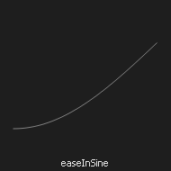 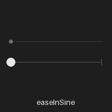 | 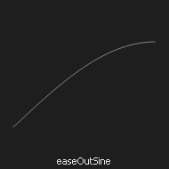 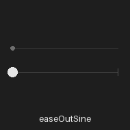 | 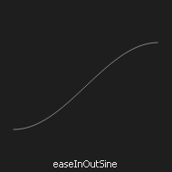  |
| **Quad** | 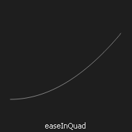  | 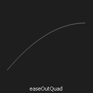  | 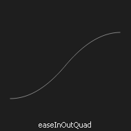 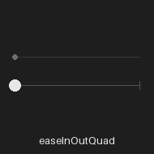 |
| **Cubic** | 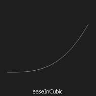  | 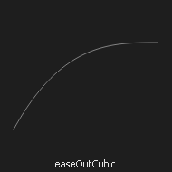  | 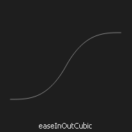 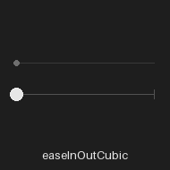 |
| **Quart** | 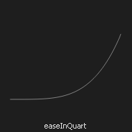  | 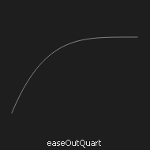  | 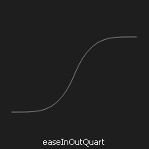 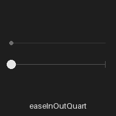 |
| **Quint** | 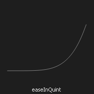 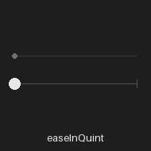 | 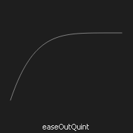  | 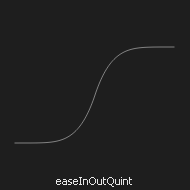  |
| **Expo** | 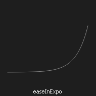 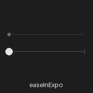 | 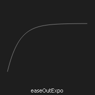  | 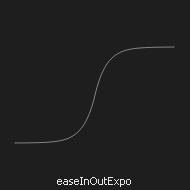  |
| **Circ** | 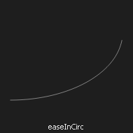 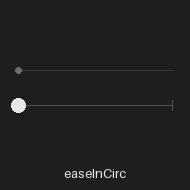 | 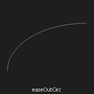  | 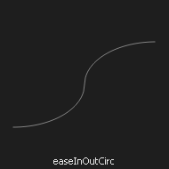 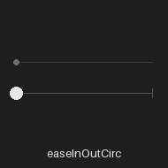 |
| **Back** | 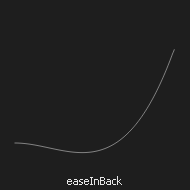 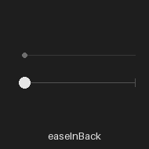 | 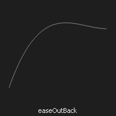  | 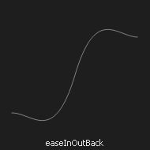 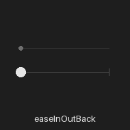 |
| **Elastic** | 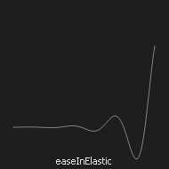 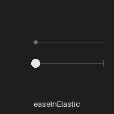 | 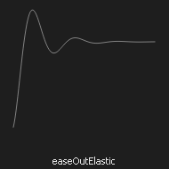 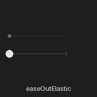 | 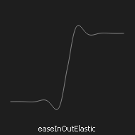 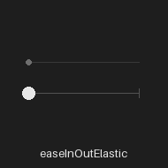 |
| **Bounce** | 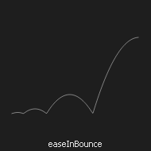 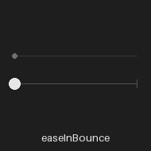 | 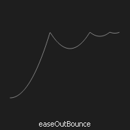 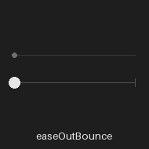 | 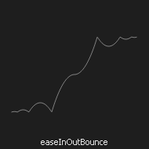 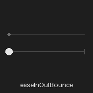 |

To regenerate the animations from the header (needs Pillow):

```sh
./build/examples/tinyeasings_plot --csv > curves.csv
python tools/make_gifs.py curves.csv doc
```

## License

[CC0 1.0](LICENSE)
